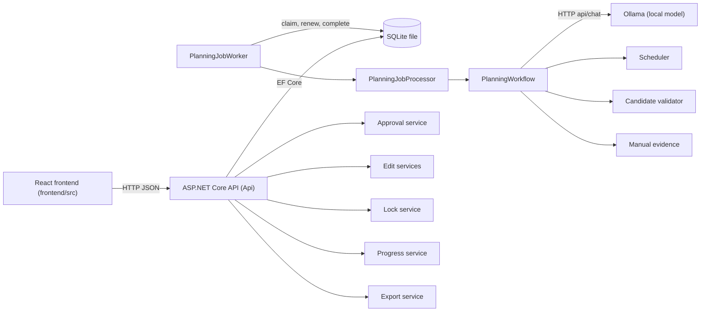
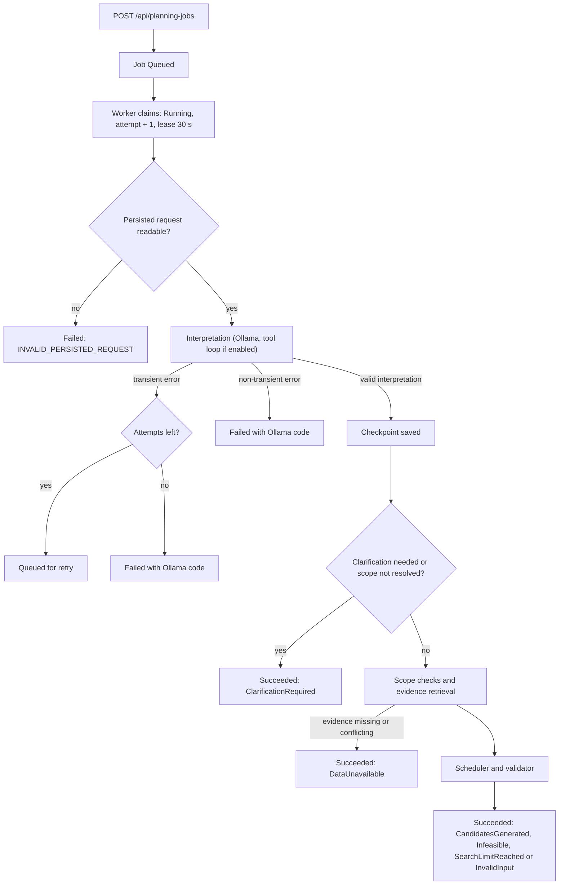
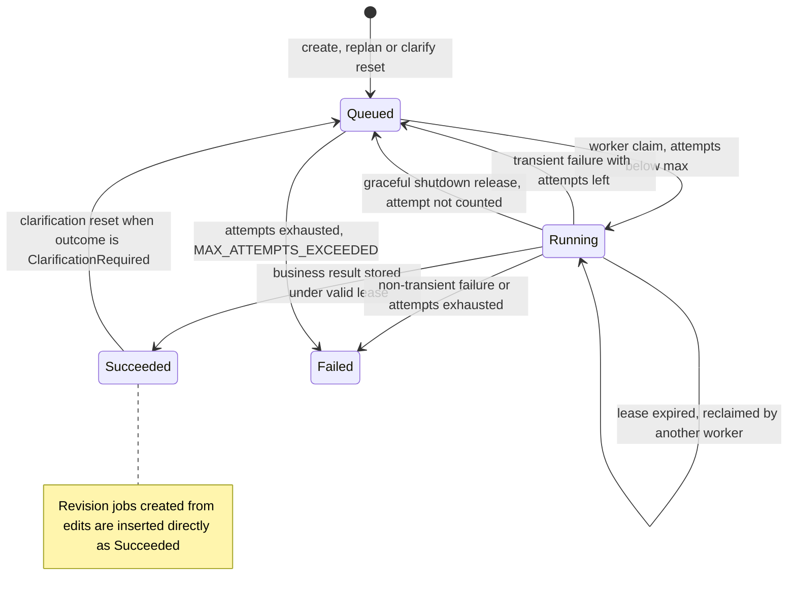
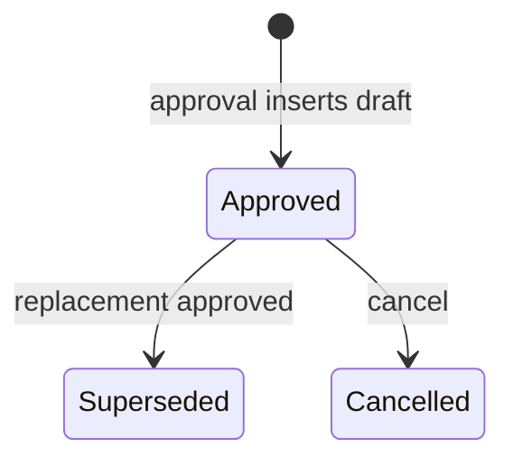

# Architecture and API

This document describes the AI Maintenance Planner as implemented in the repository. It was written from source, at HEAD `1376af5` with the AI03 changes that were then uncommitted (now committed in `08748af`). The behaviour it describes was later exercised by automated tests (see the last section); the live API and the real model were not used. Behaviour marked *unverified* was not established from source.

Related documents:
- [README.md](../README.md): setup, configuration and run commands
- [REQUIREMENTS_STATUS.md](REQUIREMENTS_STATUS.md): status of FR01–FR10, AI01–AI07 and APP01–APP06
- [FUNCTIONAL_REQUIREMENTS_TRACEABILITY.md](FUNCTIONAL_REQUIREMENTS_TRACEABILITY.md), [AI_REQUIREMENTS_TRACEABILITY.md](AI_REQUIREMENTS_TRACEABILITY.md), [FEEDBACK_TRACEABILITY.md](FEEDBACK_TRACEABILITY.md): detailed traceability
- [ACCEPTANCE_TEST_REPORT.md](ACCEPTANCE_TEST_REPORT.md): acceptance scenarios AT01–AT12 and the run register

**AI03 status:** Partially implemented. A successful real-model end-to-end run is still outstanding. The one real-model run (E-AI03-08) ended in `OLLAMA_TIMEOUT`.

---

## 1. Components

| Component | Location | Responsibility |
|---|---|---|
| Frontend | `frontend/src/` | React 19 with Vite and TypeScript. Screens: `PlanningRequestScreen`, `AlternativesScreen`, `ApprovalScreen`, `DraftDetailScreen`, `ProgressScreen`, `ImportScreen`. The root component `App.tsx` holds the role selector. `services/apiClient.ts` wraps every HTTP call. |
| API host | `src/MaintenancePlanner.Api/Program.cs` | Registers services, applies migrations and the anchor seed at startup, maps the endpoint groups, and starts the worker. About 35 service registrations. |
| Endpoints | `src/MaintenancePlanner.Api/Endpoints/` | Minimal-API endpoint groups: planning jobs, approval, edits, progress, imports, history, and catalogue reads. |
| Worker | `src/MaintenancePlanner.Api/Workers/PlanningJobWorker.cs` | `BackgroundService` that claims queued jobs, renews their lease, and records the result or failure. |
| Processor | `src/MaintenancePlanner.Infrastructure/PlanningJobs/PlanningJobProcessor.cs` | Reads the persisted request, adds replacement context (completed tasks, in-progress placements, releasable reservations, locks), and runs the workflow. |
| Workflow | `src/MaintenancePlanner.Application/Planning/PlanningWorkflow.cs` | Interprets the request, checks scope, retrieves evidence, runs the scheduler, merges saved candidates, and returns a typed result. |
| Scheduler | `src/MaintenancePlanner.Application/Planning/DeterministicPlanningScheduler.cs` | Deterministic heuristic on a 30-minute grid, with two scheduling policies (stable technician ID, and lowest hourly cost). |
| Validator | `src/MaintenancePlanner.Application/Validation/PlanningCandidateValidator.cs` | The single deterministic rule set: windows, durations, predecessors, skills, availability, overlaps, crew sizes, part compatibility and stock. |
| Cost | `src/MaintenancePlanner.Application/Planning/CandidateCostCalculator.cs` | Labour cost in decimal, completion time, and the lowest-cost marker. Currency is `UNKNOWN` (see §11). |
| AI interpreter | `src/MaintenancePlanner.Infrastructure/Planning/OllamaPlanningRequestInterpreter.cs` | Calls Ollama `api/chat`, runs the optional tool loop, and validates the final JSON. |
| Tools | `src/MaintenancePlanner.Application/Planning/Tools/` | Six tools exposed to the model (§8). Registered by `Infrastructure/Planning/PlanningToolServiceCollectionExtensions.cs`. |
| Approval | `src/MaintenancePlanner.Infrastructure/Approvals/DraftApprovalService.cs` | Approval, replacement approval and cancellation, each in one database transaction. |
| Edits and revisions | `src/MaintenancePlanner.Infrastructure/Edits/` | Task edits, their validation, and creation of a revision job from edits. |
| Locks | `src/MaintenancePlanner.Infrastructure/Locks/TaskLockService.cs` | Lock and unlock of tasks to technicians on an approved draft. |
| Progress | `src/MaintenancePlanner.Infrastructure/Planning/PlanProgressService.cs` | Task status (NotStarted, InProgress, Completed), mark-complete, and part consumption. |
| Export | `src/MaintenancePlanner.Infrastructure/Planning/PlanExportService.cs` | JSON and PDF export of approved drafts only (iTextSharp for PDF). |
| Evidence | `src/MaintenancePlanner.Infrastructure/ManualEvidence/` | Text and PDF manual retrieval (PdfPig) and imported manuals. |
| Persistence | `src/MaintenancePlanner.Infrastructure/Persistence/` | EF Core `MaintenancePlannerDbContext`, `DatabaseInitializer`, 18 migrations. |
| Tests | `tests/MaintenancePlanner.UnitTests/`, `tests/MaintenancePlanner.IntegrationTests/` | xUnit tests. No test references the repository database file. |

## 2. Planning workflow

### Normal path

1. `POST /api/planning-jobs` stores a job with status `Queued`. The `Idempotency-Key` header becomes the job's `OperationId`, and a SHA-256 fingerprint of the request is kept (§5.6).
2. The worker claims the oldest eligible job: status `Queued` with attempts below the maximum, or a `Running` job whose lease has expired. The claim sets `Running`, increments `AttemptCount`, and sets a 30-second lease.
3. The processor reads the persisted request. For a replacement job it adds the original draft's completed tasks, in-progress placements, locks, and releasable reservations.
4. The workflow checks assets and window, loads each task catalogue, and asks the interpreter for an interpretation.
5. If the interpretation is valid, it is checkpointed. If a restart happens later, the checkpoint is reused and the model is not called again.
6. The workflow checks scope and retrieves evidence. The scheduler builds candidates. Saved candidates from the model are merged in (§8).
7. The worker stores the result as `Succeeded`. The stored result carries an `outcome` such as `CandidatesGenerated`, `ClarificationRequired`, `DataUnavailable`, `Infeasible`, `InvalidInput` or `SearchLimitReached`.

### Failure paths

- A missing or conflicting clarification (`ClarificationRequired`) is a business result, not a failure. The job is `Succeeded`.
- Missing or conflicting manual evidence yields `DataUnavailable` (`MANUAL_EVIDENCE_UNAVAILABLE`, `MANUAL_EVIDENCE_CONFLICT`, `MANUAL_EVIDENCE_CONFLICT_CROSS_DOCUMENT`).
- A model call that fails with a transient error (see §10) returns the job to `Queued` if attempts remain, otherwise it becomes `Failed`.
- A non-transient processing failure (for example `INVALID_PERSISTED_REQUEST`) sets `Failed` at once.

The exact mapping from scheduler results to outcome names is in `Application/Planning/PlanningWorkflowResultMapper.cs`.

## 3. Persistence

**Storage.** A single SQLite file. The default path is `../../maintenance-planner.db` relative to the API project, which is the repository-root file (`appsettings.json`). `DatabaseInitializer.InitializeAsync` runs at startup: it adopts an existing schema, applies the migrations, and inserts the anchor seed only where records are missing.

**Entities** (`MaintenancePlannerDbContext`, 15 `DbSet`s): `Asset`, `SpareParts`, `SparePartAssetCompatibility` (join table), `MaintenanceHistoryRecords`, `MaintenanceTaskDefinitions`, `Technicians`, `TechnicalSkills`, `TechnicianAvailabilities`, `MaintenanceWindows`, `PlanningJobs`, `Drafts`, `Reservations`, `LockedTaskAssignments`, `EditedTaskPlacements`, `DraftTaskProgress`, `BusinessActionRecords`.

**Verified keys, indexes and relationships** (`MaintenancePlannerDbContext.cs`):

| Relationship or constraint | Behaviour |
|---|---|
| `PlanningJob.OperationId` | Unique index. This is the database guard for job creation idempotency. |
| `Draft.PlanningJobId` | Unique index (migration `AddUniqueConstraintDraftPlanningJobId`). At most one draft per job. |
| `Draft` → `PlanningJob` | Delete restricted. |
| `Draft` → `Reservations` | Delete cascades. |
| `Technician` → `TechnicalSkills`, `TechnicianAvailabilities` | Delete cascades. |
| `MaintenanceTaskDefinition` → `Asset`, `SparePart`, predecessor task | Delete restricted. |
| `MaintenanceHistoryRecord` → `Asset` | Delete restricted. Index on (`AssetId`, `PerformedAt`). |
| `PlanningJob` | Index on (`Status`, `CreatedAtUtc`). |
| `LockedTaskAssignment` | Unique index on (`DraftId`, `TaskId`). At most one lock per task per draft. Delete restricted. |
| `EditedTaskPlacement` | Unique index on (`DraftId`, `TaskId`). Delete cascades from the draft. |
| `BusinessActionRecord` | Indexes on (`PlanningJobId`, `PerformedAtUtc`) and (`DraftId`, `PerformedAtUtc`). |
| `SparePartAssetCompatibility` | Composite key (`SparePartId`, `AssetId`). |

**Transactions.** Approval, replacement approval, cancellation, progress updates and lock changes each open an explicit database transaction (`BeginTransactionAsync`). Code comments say SQLite begins these transactions as `IMMEDIATE`. That is a comment, not something this document verified at runtime.

## 4. States and transitions

### Planning job (`PlanningJobStatus`)

Values: `Queued`, `Running`, `Succeeded`, `Failed`, `Cancelled`.

- `Cancelled` is declared but **no code path assigns it**. It is unreachable in the current source.
- The clarification reset (`UpdateAndResetAsync`) sets `Queued`, clears the result and checkpoint, and resets attempts to zero.

### Draft (`DraftStatus`)

Values: `Pending`, `Approved`, `Cancelled`, `Superseded`.

- `Pending` is the entity's default value, but **no code path assigns it**. Every draft is inserted as `Approved`.
- A cancelled draft stays cancelled. A repeated cancel returns success.

### Reservation (`ReservationStatus`)

Values: `Pending`, `Confirmed`, `Cancelled`.

- Approval inserts reservations as `Confirmed`. `Pending` is never assigned.
- A replacement approval sets the replaced draft's unconsumed reservations to `Cancelled`.
- Cancellation sets the draft's unconsumed reservations to `Cancelled`.
- When a part task completes, the reservation's `CompletedAtUtc` is set. Its status stays `Confirmed`. Consumed reservations keep counting towards reserved quantity, and cancellation does not release them.

### Task progress (`TaskProgressStatus`)

Values: `NotStarted`, `InProgress`, `Completed`. The only allowed transitions are `NotStarted` → `InProgress` and `InProgress` → `Completed` (`IsAllowedTransition`). Any other transition is rejected with `INVALID_TASK_TRANSITION`.

### Task edit validation

`EditedPlacement` results use the codes `TASK_NOT_IN_PLAN`, `TASK_ALREADY_COMPLETED`, `TASK_IN_PROGRESS`, `LOCKED_ASSIGNMENT_CHANGED` and `NO_REMAINING_WORK` (`EditedPlanValidator.cs`).

## 5. Approval, reservation, locks, cancellation, idempotency and conflicts

### 5.1 Approval (`POST /api/drafts/{planningJobId}/approve`)

`DraftApprovalService.ApproveDraftAsync` runs these checks in order. Any failure rolls back the transaction.

1. The DbContext must have no unsaved changes, or the service throws.
2. The job must exist (`PLANNING_JOB_NOT_FOUND`). For a replacement, the job must have an original (`NOT_A_REPLACEMENT_JOB`).
3. The job must be `Succeeded` with a result (`PLANNING_JOB_NO_RESULT`). The result must be readable (`PLANNING_RESULT_UNREADABLE`) and have outcome `CandidatesGenerated` (`PLANNING_JOB_NOT_APPROVABLE`).
4. **If a draft already exists for the job, `ExistingDraftResult` decides the outcome** (`DraftApprovalService.cs`):
   - `Approved`: returned as success when the request has no candidate index, or an index whose candidate matches the approved candidate. A different index returns `CANDIDATE_SELECTION_MISMATCH`.
   - `Cancelled`: `DRAFT_CANCELLED`. `Superseded`: `DRAFT_SUPERSEDED`. Any other state: `INVALID_DRAFT_STATE`.
5. The candidate list must not be empty (`PLANNING_JOB_NO_CANDIDATES`). An index is required when there is more than one candidate (`CANDIDATE_SELECTION_REQUIRED`), and it must be in range (`CANDIDATE_NOT_FOUND`).
6. The request and candidate must be readable (`CANDIDATE_UNREADABLE`). Assets and window must be present (`PLANNING_REQUEST_INCOMPLETE`). The candidate must have placements (`CANDIDATE_HAS_NO_TASKS`).
7. For a replacement, the original job's approved draft must exist (`NO_APPROVED_ORIGINAL_DRAFT`). Its completed tasks are read.
8. The candidate is **revalidated** by `PlanningCandidateValidator` with the completed tasks. Violations other than `PART_UNAVAILABLE` return `CANDIDATE_NO_LONGER_VALID`.
9. Tasks in progress on the replaced draft must keep their placement. If one does not, the result is `CANDIDATE_NO_LONGER_VALID` with `resourceType` `Candidate` and `resourceId` `IN_PROGRESS_TASK_NOT_PRESERVED` (`DraftApprovalService.FindInProgressTaskNotPreserved`).
10. Technician time is checked against other approved drafts (`TECHNICIAN_TIME_CONFLICT`).
11. **Parts are reserved** (`ReservePartsAsync`). Retained confirmed reservations plus the required quantity must not exceed on-hand stock (`INSUFFICIENT_INVENTORY`). The replaced draft's unconsumed reservations are released. Confirmed reservations are inserted, and `SparePart.ReservedQuantity` is set.
12. The replaced draft becomes `Superseded`.
13. The new draft is inserted as `Approved` with `ApprovedCandidatePayload`. In-progress tasks carry over as `InProgress`. One lock is created per placed task for its first technician. An `Approved` business action is recorded. Changes are saved and the transaction commits.
14. **Concurrent creation.** A unique-constraint violation on `Draft.PlanningJobId` rolls back and returns the existing approved draft, or `CONCURRENT_DRAFT_CREATION` if none exists. A concurrency exception returns `CONCURRENT_MODIFICATION`. A source comment says SQLite transactions begin `IMMEDIATE`, so concurrent approvals are serialised (`DraftApprovalService.cs:60`). The concurrent-approval tests in `AT06ConcurrentApprovalTests.cs` and `F01ConcurrentInventoryApprovalFileDatabaseTests.cs` passed (R-13, R-14).

Success returns `202 Accepted` with `Location: /api/drafts/{draftId}`. Failures return `409` with an `ApprovalErrorResponse`.

### 5.2 Cancellation (`POST /api/drafts/{draftId}/cancel`)

`CancelDraftAsync`, in one transaction:

- Not found: `404`.
- Already `Cancelled`: success (idempotent).
- Not `Approved`: `409` with `INVALID_DRAFT_STATE`.
- Otherwise: releases each part's **unconsumed** reservations from `ReservedQuantity` (never below zero), marks those reservations `Cancelled`, sets the draft to `Cancelled`, and records a `Cancelled` business action. A missing part returns `SPARE_PART_NOT_FOUND` and rolls back.

Success returns `204 No Content`.

### 5.3 Locks (`PUT` and `DELETE /api/drafts/{draftId}/locks/{taskId}`)

`TaskLockService.LockAsync`, in one transaction, checks in order:

- The draft must exist and be approved, and the task must be in its plan. Codes: `DRAFT_NOT_FOUND`, `DRAFT_NOT_APPROVED`, `TASK_NOT_IN_PLAN`.
- A task that is `InProgress` cannot be locked (`TASK_IN_PROGRESS`). A `Completed` task cannot be locked (`TASK_ALREADY_COMPLETED`).
- The technician must exist (`LOCKED_TECHNICIAN_NOT_FOUND`), hold the task's skills (`LOCKED_TECHNICIAN_UNQUALIFIED`), and be available across the window (`LOCKED_TECHNICIAN_UNAVAILABLE`).
- Locking to the technician already holding the lock succeeds without change (idempotent).

Results: `204` on success; `404`, `409` or `400` with a `TaskLockChangeResult` otherwise.

Unlock (`DELETE`): removing a lock that does not exist succeeds and changes nothing. It is rejected with `409` for a draft that is not approved (`DRAFT_NOT_APPROVED`) or a task that is in progress or completed (`TASK_IN_PROGRESS`, `TASK_ALREADY_COMPLETED`), and with `404` for `DRAFT_NOT_FOUND` or `TASK_NOT_IN_PLAN` (endpoint description and `ToLockResult` in `EditEndpoints.cs`).

### 5.4 Task progress and mark-complete

- `POST /api/drafts/{draftId}/tasks/{taskId}/progress` runs `UpdateTaskStatusAsync` in one transaction. It returns `404` for `DRAFT_NOT_FOUND` or `TASK_NOT_IN_PLAN`, and `409` for `DRAFT_NOT_APPROVED` or `INVALID_TASK_TRANSITION`.
- `POST /api/drafts/{draftId}/mark-task-complete?sparePartId=...` returns `400` if `sparePartId` is blank, `404` if the draft is missing, and `409` with the message "Draft must be approved to mark tasks complete" if it is not approved. Otherwise it returns `200` with a `TaskCompletionResponse`. Each call marks **one** incomplete reservation of that part as consumed (`CompletedAtUtc`) and records `PartConsumptionRecorded` (`PlanProgressService.MarkTaskCompleteAsync`; the endpoint's description text says "all", but the service code marks one). A repeated call therefore consumes the next incomplete reservation. When none is left it returns `succeeded` false with "All tasks for this spare part are already completed", still as HTTP `200`. A part with no reservation in the draft also returns `succeeded` false.

### 5.5 Edits and revisions

- `POST /api/drafts/{draftId}/task-edits` validates the submitted edits against the whole plan, with completed and in-progress work held fixed (`EditedPlanValidator`), and stores them.
- `POST /api/drafts/{draftId}/task-edits/revision` creates a **planning job with status `Succeeded`** directly. Its `OriginalJobId` is the draft's job, and its result is the revised candidate. Failure codes defined in `EditRevisionResult` are `DRAFT_NOT_FOUND`, `DRAFT_NOT_APPROVED`, `NO_TASK_EDITS`, `TASK_EDITS_INVALID`, `APPROVED_SNAPSHOT_UNAVAILABLE` and `OPERATION_ID_REUSED`.

### 5.6 Idempotency

| Operation | Mechanism | Repeated request result |
|---|---|---|
| Create planning job | `Idempotency-Key` (GUID) becomes `OperationId`, which has a unique index | Same key, same payload: the existing job is returned. Same key, different payload: `409`. |
| Replan | Same mechanism, through `CreateReplacementAsync` | Same as above. The `409` message reads "This Idempotency-Key has already been used with a different planning request." |
| Approve | Existing draft for the job is returned; unique index on `Draft.PlanningJobId` | Returns the existing approved draft. No new rows. |
| Cancel | Status check | Returns success if already cancelled. |
| Lock | Existing lock check | Same technician: success. |
| Task progress | Only forward transitions allowed | Repeating a transition is rejected with `INVALID_TASK_TRANSITION`. |
| Worker completion | Lease token and version check | A stale worker's completion is refused. |

### 5.7 Conflict summary

Approval conflicts are returned as `409` with `ApprovalErrorResponse { resourceType, reason, resourceId, message }`. The distinct approval codes in source are: `APPROVED_SNAPSHOT_UNAVAILABLE`, `CANDIDATE_HAS_NO_TASKS`, `CANDIDATE_NO_LONGER_VALID`, `CANDIDATE_NOT_FOUND`, `CANDIDATE_SELECTION_MISMATCH`, `CANDIDATE_SELECTION_REQUIRED`, `CANDIDATE_UNREADABLE`, `CONCURRENT_DRAFT_CREATION`, `CONCURRENT_MODIFICATION`, `DRAFT_CANCELLED`, `DRAFT_SUPERSEDED`, `INSUFFICIENT_INVENTORY`, `INVALID_DRAFT_STATE`, `NO_APPROVED_ORIGINAL_DRAFT`, `NOT_A_REPLACEMENT_JOB`, `PLANNING_JOB_NO_CANDIDATES`, `PLANNING_JOB_NO_RESULT`, `PLANNING_JOB_NOT_APPROVABLE`, `PLANNING_JOB_NOT_FOUND`, `PLANNING_REQUEST_INCOMPLETE`, `PLANNING_RESULT_UNREADABLE`, `SPARE_PART_NOT_FOUND`, `TECHNICIAN_TIME_CONFLICT`.

## 6. API endpoints

All endpoints are minimal-API routes in `src/MaintenancePlanner.Api/Endpoints/`. JSON request and response bodies use the records listed in the source file named in the Notes column. Errors are returned as plain strings unless the table says otherwise.

### Catalogue and imports

| Method | Path | Request | Success | Other statuses | Notes |
|---|---|---|---|---|---|
| GET | `/api/assets` | none | `200` list of `AssetResponse` | none | `MaintenancePlannerEndpoints.cs` |
| GET | `/api/technicians` | none | `200` list of `TechnicianResponse` | none | |
| GET | `/api/spareparts` | none | `200` list of `SparePartResponse` | none | |
| GET | `/api/maintenance-windows` | none | `200` list of `MaintenanceWindowResponse` | none | |
| GET | `/api/task-catalogue/{assetId}` | none | `200` list of `MaintenanceTaskResponse` | `404` | |
| POST | `/api/imports/{dataset}` | multipart file | `200` `ImportReport` | `400`, `422` with `ImportReport` | Datasets: `assets`, `spare-parts`, `technicians`, `technician-availability`, `tasks`, `maintenance-history`. `ImportReport.Imported` states whether the import was applied. `ImportEndpoints.cs` |
| POST | `/api/imports/manuals` | multipart file, with `documentId` and `version` fields | `200` `ImportReport` | `400`, `422` with `ImportReport` | `ImportEndpoints.cs` |

### Planning jobs

| Method | Path | Request | Success | Other statuses | Notes |
|---|---|---|---|---|---|
| POST | `/api/planning-jobs` | `Idempotency-Key` header (GUID); body `CreatePlanningJobRequest { requestText (required), assetIds (required, non-empty, non-blank), windowId? }` | `202` `PlanningJobAcceptedResponse { jobId, statusUrl }` | `400` problem details for a bad key or payload; `409` problem details when the key was used with a different request | `PlanningJobEndpoints.cs` |
| GET | `/api/planning-jobs/{id}` | none | `200` `PlanningJobStatusResponse { jobId, status, attemptCount, maxAttempts, currentStep, resultPayload, clarificationPayload, failureCode, createdAtUtc, startedAtUtc, completedAtUtc, errorMessage }` | `404` | |
| POST | `/api/planning-jobs/{id}/clarify` | `SubmitClarificationRequest { windowId?, additionalContext? }` | `200` `PlanningJobStatusResponse` (status `Queued`) | `400` string, `404` | Only when the outcome is `ClarificationRequired`. `WindowId` is required. The handler replaces the request's window and resets the job. **`additionalContext` is accepted but not used by the handler** (see §11). |
| POST | `/api/planning-jobs/{originalJobId}/replan` | `Idempotency-Key` header; body `CreatePlanningJobRequest` | `202` `ReplanAcceptedResponse { newJobId, statusUrl }` | `404` if the original job is missing; `409` string if it has no approved draft, the key is missing or invalid, the body is invalid, or the key was reused with a different request | `PlanningJobEndpoints.cs` |
| GET | `/api/planning-jobs/{jobId}/revisions` | none | `200` list of `PlanningJobRevisionResponse { id, status, createdAtUtc, originalJobId }` | `404` | Revision chain of the job |
| GET | `/api/planning-jobs/{jobId}/candidates` | none | `200` `PlanningJobCandidatesResponse { jobId, status, outcome, candidates, interpretation }` | `404`; `400` string while queued or running, when failed, when there is no result, when the outcome is `ClarificationRequired`, or for any other non-candidate outcome | `CandidateResponse` includes `rationale`, `requestedTaskIds`, `dependencyTaskIds`, `taskPlacements`, `evidenceReferences`, `totalLabourCostAmount`, `totalLabourCostCurrency`, `completionTimeMinutes`, `deferralReasons`, `isLowestCostCandidate`, `costComparabilityWarning` |
| GET | `/api/planning-jobs/{jobId}/history` | none | `200` list of `BusinessActionResponse { id, action, performedBy, performedAtUtc, planningJobId, draftId, taskId, details }` | `404` | `HistoryEndpoints.cs` |

### Approval and drafts

| Method | Path | Request | Success | Other statuses | Notes |
|---|---|---|---|---|---|
| POST | `/api/drafts/{planningJobId}/approve` | optional body `ApproveDraftRequest { candidateIndex? }` | `202` with `Location: /api/drafts/{draftId}` | `409` `ApprovalErrorResponse { resourceType, reason, resourceId, message }` | §5.1 |
| POST | `/api/drafts/{draftId}/cancel` | none | `204` | `404`, `409` `ApprovalErrorResponse` | §5.2 |
| GET | `/api/drafts/{draftId}` | none | `200` `DraftDetailResponse { draftId, planningJobId, status, createdAtUtc, approvedAtUtc, selectedCandidate, reservations, interpretation }` | `404` | |
| GET | `/api/drafts` | none | `200` list of `SavedPlanResponse` | none | First fields: `draftId`, `planningJobId`, `originalJobId`, `status`, `createdAtUtc`, `approvedAtUtc`, `assetIds`, `windowId`. The remaining fields are in `HistoryEndpoints.cs`. |

### Task edits and revisions

| Method | Path | Request | Success | Other statuses | Notes |
|---|---|---|---|---|---|
| POST | `/api/drafts/{draftId}/task-edits` | `TaskEditsSubmissionRequest { edits: [TaskEditRequest { taskId, newStart, newEnd, newTechnicianIds }] }` | `200` `TaskEditsResponse { draftId, editedTasks }` | `404`, `409` | `EditEndpoints.cs` |
| GET | `/api/drafts/{draftId}/task-edits` | none | `200` list of `EditedTaskPlacementResponse` | `404` | |
| DELETE | `/api/drafts/{draftId}/task-edits/{taskId}` | none | `204` | `404` | |
| DELETE | `/api/drafts/{draftId}/task-edits` | none | `204` | `404` | Clears all edits of the draft |
| POST | `/api/drafts/{draftId}/task-edits/validate` | none | `200` `EditValidationResult { draftId, isValid, violations, validEditsCount, invalidEditsCount }` | `404`, `409` | `ValidationViolation { taskId, code, message }` |
| POST | `/api/drafts/{draftId}/task-edits/revision` | none | `202` `ReplanAcceptedResponse` | `400` string, `404`, `409` `EditRevisionResult` | §5.5 |

### Locks

| Method | Path | Request | Success | Other statuses | Notes |
|---|---|---|---|---|---|
| GET | `/api/drafts/{draftId}/locks` | none | `200` list of `TaskLockResponse { taskId, technicianId }` | `404` | |
| PUT | `/api/drafts/{draftId}/locks/{taskId}` | `TaskLockRequest { technicianId? }` | `204` | `400` string, `404` and `409` with `TaskLockChangeResult { succeeded, failureCode, failureReason }` | §5.3 |
| DELETE | `/api/drafts/{draftId}/locks/{taskId}` | none | `204` | `400`, `404` and `409` with `TaskLockChangeResult` | Unlock. Its checks were not read in full (§5.3). |

### Progress and export

| Method | Path | Request | Success | Other statuses | Notes |
|---|---|---|---|---|---|
| POST | `/api/drafts/{draftId}/mark-task-complete` | query parameter `sparePartId` | `200` `TaskCompletionResponse { succeeded, failureReason }` | `400`, `404`, `409` string | §5.4 |
| GET | `/api/drafts/{draftId}/progress` | none | `200` `PlanProgressResponse { draftId, totalRequired, completedQuantity, remainingQuantity, tasks, taskStatuses }` | `404` | `taskStatuses` lists `TaskStatusResponse { taskId, status, updatedAtUtc }` |
| POST | `/api/drafts/{draftId}/tasks/{taskId}/progress` | `TaskStatusUpdateRequest { status }`, with `NotStarted`, `InProgress` or `Completed` | `200` `TaskStatusUpdateResponse { succeeded, taskId, status, failureCode?, failureReason? }` | `400` string for an invalid status; `404` with `TaskStatusUpdateResponse` for `DRAFT_NOT_FOUND` or `TASK_NOT_IN_PLAN`; `409` with `TaskStatusUpdateResponse` for other rejections | §5.4 |
| GET | `/api/drafts/{draftId}/export/json` | none | `200` file (JSON) | `404`, `409` string for a draft that is not approved | Approved drafts only |
| GET | `/api/drafts/{draftId}/export/pdf` | none | `200` file (PDF) | `404`, `409` string for a draft that is not approved | Approved drafts only |

### Development only

- Swagger UI is registered only when the environment is `Development` (`Program.cs`), at the default ASP.NET Core path `/swagger`.
- `GET /weatherforecast` is a template endpoint left in `Program.cs`. It is not part of the planner's API.

## 7. Configuration

Read from `src/MaintenancePlanner.Api/appsettings.json`. Environment variables override settings, using `__` in place of `:`.

| Key | Repository value | Code default | Purpose |
|---|---|---|---|
| `ConnectionStrings:MaintenancePlanner` | `Data Source=../../maintenance-planner.db` | none | SQLite file, resolved against the content root |
| `Ollama:BaseUrl` | `http://localhost:11434` | none | Ollama endpoint. Must be absolute HTTP or HTTPS. |
| `Ollama:Model` | `qwen2.5:7b` | none | Model name |
| `Ollama:TimeoutSeconds` | `180` | none | Per-request timeout, validated between 1 and 600 |
| `Ollama:EnableTools` | not set | `false` | Enables the tool loop (§8) |
| `Ollama:MaxToolCalls` | not set | `6` | Tool-call limit, validated between 1 and 20 |
| `ManualImports:Directory` | not set | `data/manuals/imported` under the repository root (`Program.cs:71–78`) | Imported PDF manuals |
| `PlanningJobs:PollInterval` | not set | 1 second (`PlanningJobWorkerOptions`) | Worker polling. The section `PlanningJobs` is bound at `Program.cs:105–106`. |
| `PlanningJobs:LeaseDuration` | not set | 30 seconds | Worker lease. The heartbeat is one third of this value (`PlanningJobWorker.cs`). |
| `VITE_API_BASE` (frontend) | not set | `http://localhost:5083` | API base URL for the frontend |

**Logging:** `Information` by default, and `Warning` for `Microsoft.AspNetCore` (`appsettings.json`).

**CORS:** `AllowAnyOrigin` (`FrontendCors.cs`). This is acceptable for a local proof of concept only.

## 8. AI model and tool loop

### Interpretation without tools (default)

One request to `api/chat` with `format: "json"` and two messages: a system prompt and a user message. The user message is JSON containing the request text, the selected asset IDs, the asset list, and the task catalogue. The model's reply must match `InterpreterOutput`. Unknown members are rejected (`UnmappedMemberHandling.Disallow`). The reply is then checked against the application's rules, including identifiers, scope resolution values, and one mapping per proposed task.

### Interpretation with tools (`Ollama:EnableTools = true`)

- **Tool rounds** are sent with the tool definitions and **without** `format`. Each requested call goes to `PlanningToolDispatcher`. Each result is returned as a `tool` message, with `tool_name`.
- **Final answer:** when the model stops calling tools, one request is sent with `format: "json"` and **no tools**. Ollama does not document `format` and `tools` together, so the implementation never combines them. The final reply is checked by the same validation as above.
- **Call limit:** `MaxToolCalls` counts every call. A round that would exceed the limit fails with `OLLAMA_TOOL_CALL_LIMIT` before any of its calls run.
- **Result size:** a serialized tool result longer than 32,768 characters is replaced by `INVALID_TOOL_RESULT`.
- **Prompt:** when tools are on, the user message includes `selectedWindowId`, set from the request's window. The system prompt tells the model to use that value for every window argument. A final answer that carries its own window is rejected, because the interpretation contract has no window field.

### Tools

| Tool | Arguments | Data source | Side effects |
|---|---|---|---|
| `lookup_stock` | optional `windowId`, `assetId`, `partIds` | Stock provider (window-aware) | None |
| `get_technician_availability` | optional `technicianIds`, `windowId` | Technician queries | None. Results state that committed time is not subtracted. |
| `get_task_catalogue` | required `assetId` | Task catalogue | None |
| `validate_schedule` | `assetIds`, `windowId`, `placements` | `PlanningCandidateValidator` | None |
| `calculate_cost` | `assetIds`, `windowId`, `placements` | Validator, then `CandidateCostCalculator` with stored rates | None. Refused if the candidate fails validation. |
| `save_candidate` | `placements` only | Job context set by the workflow; validator; cost calculator | Adds the candidate to an in-memory list for the current attempt. Nothing is written to the database. |

Each tool result is an envelope: `{ "ok": true, "data": ... }` or `{ "ok": false, "error": { "code", "message" } }`. Tool-level error codes: `UNKNOWN_TOOL`, `INVALID_ARGUMENTS`, `INVALID_TOOL_RESULT`, `TOOL_EXECUTION_FAILED`, `UNKNOWN_ASSET`, `UNKNOWN_WINDOW`, `UNKNOWN_PART`, `UNKNOWN_TECHNICIAN`, `NO_PLANNING_CONTEXT`, `PROPOSAL_LIMIT`, `INVALID_CANDIDATE`.

**Saved candidates.** `save_candidate` keeps at most three distinct candidates per planning attempt. After scheduling, the workflow adds each saved candidate to the job's candidates only if it covers exactly the required task scope and is not a copy of a scheduler candidate. The result carries `modelCandidateNotes` describing each decision. Saved candidates are not persisted separately, so a retried or resumed attempt starts without them.

### Interpreter failure codes

| Code | Transient | Cause |
|---|---|---|
| `OLLAMA_TIMEOUT` | yes | No response within `TimeoutSeconds` |
| `OLLAMA_UNAVAILABLE` | yes | Connection failure |
| `OLLAMA_HTTP_ERROR` | yes for 408, 429 and 5xx; otherwise no | Other HTTP statuses |
| `OLLAMA_INVALID_OUTPUT` | no | Malformed envelope, schema mismatch, or failed application checks |
| `OLLAMA_TOOL_CALL_LIMIT` | no | Tool calls above `MaxToolCalls` |
| `OLLAMA_TOOLS_UNAVAILABLE` | no | Tools enabled but none registered |

Caller cancellation is not converted to a provider failure.

### AI03 status

The tool loop, the six tools and the approval path of saved candidates are implemented and covered by **mocked-model tests**. One real-model run with `qwen2.5:7b` made valid tool calls, but the job failed with `OLLAMA_TIMEOUT` after two attempts on CPU-only inference. **A successful real-model end-to-end run is still outstanding.**

## 9. Failure modes and recovery

| Situation | Behaviour | Source |
|---|---|---|
| Ollama unreachable, or timeout | Transient failure. Job returns to `Queued` if attempts remain (maximum 2), otherwise `Failed`. | `PlanningJobs.FailAsync`; `PlanningJobWorkerOptions` |
| Invalid model output or tool limit | Non-transient. `Failed` immediately. | `OllamaPlanningRequestInterpreter` |
| Persisted request unreadable | Non-transient. `Failed` with `INVALID_PERSISTED_REQUEST`. | `PlanningJobProcessor` |
| Process restart during a job | The lease expires and another claim reclaims the job, increasing `AttemptCount`. | `ClaimNextAsync` |
| Restart after a valid interpretation | The checkpoint is reused, so the model is not called again. A checkpoint that is invalid for the job fails the job. | `PlanningWorkflow.ResumeFromCheckpointAsync`; `PlanningJobProcessor` |
| Graceful shutdown | The job is released to `Queued`, and the attempt is not counted. | `PlanningJobWorker`; `ReleaseAsync` |
| Stale worker completing a job it has lost | Refused, because the lease token and version no longer match. | `PlanningJobs.CompleteAsync` |
| Attempts exhausted | `Failed` with `MAX_ATTEMPTS_EXCEEDED`. | `ClaimNextAsync` |
| Two approvals of the same job | The second returns the existing draft. A unique index prevents a second draft. | `DraftApprovalService` |
| Concurrent approvals competing for the last unit of a part | Intended to be serialised by the transaction, with the stock check inside it (§5.1 step 11). **Verified by automated tests:** `AT06_TwoParallelApprovalsCompeteForFinalBR101_OnlyOneSucceeds`, the parallel HTTP test `AT06_TrueParallelApprovalsViaHttpApi_ExactlyOneSucceedsWithFinalBR101` and `ParallelApprovalsForLastUnit_OnFileDatabase_ExactlyOneReserves_LosersLeaveNoSideEffects` passed (R-13, R-14); they assert one approval and a reserved quantity of 1. The older log [CancellationConcurrency.txt](DebugAndTests/CancellationConcurrency.txt) is a historical narrative. | `DraftApprovalService.cs`; `AT06ConcurrentApprovalTests.cs`; [ACCEPTANCE_TEST_REPORT.md](ACCEPTANCE_TEST_REPORT.md) |
| Missing stock data | Reported as `PART_DATA_UNAVAILABLE`, not as zero stock. | `PlanningCandidateValidator` |
| Export of an unapproved draft | `409`. | `PlanExportService`; `PlanProgressEndpoints` |
| Failure after approval when a resource changes | **No requires-review outcome exists.** The approved draft keeps its status. | Not implemented (APP02 in REQUIREMENTS_STATUS.md) |

**Known limitations** (detail in [REQUIREMENTS_STATUS.md](REQUIREMENTS_STATUS.md)):
- No revise or repair step: validator violations are not sent back to the model (AI04).
- No before-and-after change comparison between revisions (FR07, AI06).
- Planning requests and clarifications are not recorded as business actions (FR09).
- A browser refresh or a double submit from the UI creates a second job, because each submission generates a new idempotency key (`frontend/src/App.tsx`). **Unverified** by any test (APP05).
- No retry action in the UI (APP06).

## 10. Trade-offs

Each trade-off below is either stated in source comments or documentation, or is marked as an inference.

- **Database-backed job queue with leases, not a message broker.** The claim, lease and version checks live in the database, so a restart needs no external state. *Reason stated in source comments in `PlanningJobWorker.cs` and `PlanningJobExecutionContext.cs`.*
- **One SQLite file.** This is a proof of concept with a small dataset. *Documented in `scope_assumption.md`.* Concurrency relies on SQLite transactions (§3).
- **Deterministic scheduling heuristic, not an optimiser.** Results are explainable and repeatable, and the validator is the only rule set. *Documented in `scope_assumption.md` and the requirements (§1).*
- **The model proposes; the application decides.** Stock, costs, approval validity and reservations are computed and checked in code. *Requirements §3 table and the code paths in §5.*
- **Checkpoint after validation.** An interrupted job does not re-interpret, which avoids paying for a second model call and avoids a second, possibly different, interpretation. *Source comment in `PlanningWorkflow.cs`.*
- **Saved candidates live in memory for one attempt.** They are cheap to create and cannot leave a partial database write behind. The cost is that a retry loses them. *Inference from `ModelCandidateProposals` and the workflow. Recorded as a limitation in §8.*
- **Self-declared roles.** The selector is a usability aid for a demonstration, not access control. *Documented in `BusinessActor.cs`.*
- **Lock checks mirror the scheduler's checks.** A lock accepted now is meant to be usable when replanning runs. *Source comment in `TaskLockService.cs:69` names `DeterministicPlanningScheduler` as the source of the rules. Not runtime-tested.*

## 11. Discrepancies

These are recorded here and not corrected in the source documents.

1. **Frontend technology.** `docs/scope_assumption.md` names Angular. The implemented frontend is React 19 with Vite and TypeScript (`frontend/package.json`). The requirements allow any suitable web UI (§1).
2. **Unused configuration key.** `appsettings.Development.json` contains `ConnectionStrings:Maintenance`, which no code reads. The API reads `ConnectionStrings:MaintenancePlanner`.
3. **Declared but unused states.** `PlanningJobStatus.Cancelled` and `DraftStatus.Pending` are declared, and no code path assigns them.
4. **Required plan states absent.** The requirements (§4) name "Awaiting review" and "Changes requested". Neither exists in source.
5. **Ignored clarification field.** `SubmitClarificationRequest.AdditionalContext` is accepted but not used by the clarification handler.
6. **Template endpoint.** `GET /weatherforecast` remains in `Program.cs`.
7. **Tracked database file.** The repository-root database is tracked by git, although `.gitignore` lists it. Running the API changes a tracked file.
8. **Code comment about SQLite.** A source comment says SQLite begins transactions as `IMMEDIATE`. The parallel-approval tests pass (R-13, R-14), which supports but does not prove this.

## 12. Verification status

**Verified from source in this document:** components and their files (§1); the planning flow and its failure paths (§2); the persistence keys, indexes and relationships (§3); the job, draft, reservation and task states and their transitions (§4); approval, cancellation, locks, progress, edits, revisions and idempotency (§5); endpoint methods, paths, request and response shapes, and status codes (§6); configuration keys and defaults (§7); the tool loop, its tools and its error codes (§8); recovery paths (§9).

**Not verified from source in this document:**
- Everything in this document is a reading of source. Items that an earlier version listed as unverified (the in-progress conflict code, repeated mark-task-complete, the unlock checks, the revision endpoint's header requirement, the outcome names) were later read from source and are now stated in §5 and in [API.md](API.md). They are covered by the automated runs described at the end of this document.

**Verification status.** The behaviour described here is what the source shows. Automated tests exercised it (below); the API was not started and Ollama was not invoked. The acceptance results are in [ACCEPTANCE_TEST_REPORT.md](ACCEPTANCE_TEST_REPORT.md). **AI03 real-model end-to-end verification remains outstanding.**

**Test evidence.** Focused automated runs on 2026-10-29 (R-13 to R-20 in the acceptance report) exercised the approval, reservation, idempotency, replacement, progress, recovery, import and AI03 behaviour described above. All passed. They used a mocked model and isolated in-memory or temporary databases, not the live API or the real model.

**Export content (read from `PlanExportService.cs`).** The JSON and PDF exports of an approved draft contain the draft ID, approval time, planning job ID, overall and per-part progress, and the approved task placements (task, start, end, technicians, status). They do **not** contain assumptions, evidence references or deferred work, which requirement FR10 lists. The PDF shows the placements and embeds the same JSON text.
