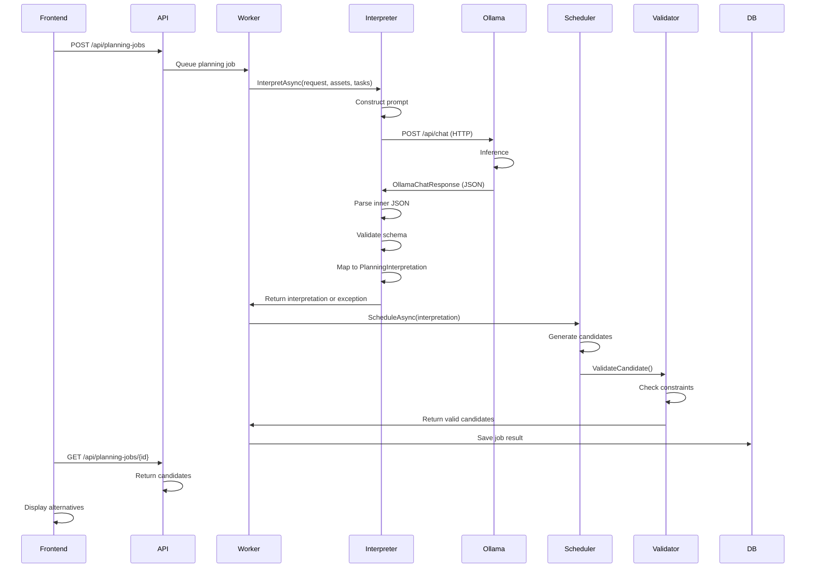

# Ollama Integration and Testing
## AI Maintenance Planner

**Date:** 2026-10-26  
**Scope:** Ollama LLM integration, request/response handling, testing, troubleshooting, and configuration.

---

## Table of Contents

1. [Overview](#overview)
2. [Configuration](#configuration)
3. [Request/Response Flow](#requestresponse-flow)
4. [Prompt Construction](#prompt-construction)
5. [Error Handling](#error-handling)
6. [Smoke Testing](#smoke-testing)
7. [Troubleshooting](#troubleshooting)

---

## Overview

The AI Maintenance Planner integrates with **Ollama**, a locally-hosted language model service, to interpret natural-language maintenance requests and propose task interpretations.

**Key Facts:**
- **Service:** Ollama (local LLM inference)
- **Default Model:** `qwen2.5:7b` (Qwen 2.5, 7 billion parameters)
- **Default URL:** `http://localhost:11434`
- **Communication:** HTTP REST API
- **Timeout:** 180 seconds (configurable)
- **Output Format:** JSON (enforced by request)
- **Fallback:** None; Ollama unavailability causes job failure

**Responsibilities (Ollama):**
- Interpret natural-language request and proposed tasks
- Map user intent to authoritative task IDs
- Detect and report missing information (clarification needed)
- Return structured JSON interpretation

**Responsibilities (Backend Services):**
- Deterministic scheduling and validation (not LLM)
- Constraint checking (skills, availability, stock)
- Reservation management and approval
- Cost calculation and export

---

## Configuration

### Environment Variables

| Variable | Default | Description | Example |
|----------|---------|---|---|
| `Ollama__BaseUrl` | `http://localhost:11434` | Ollama endpoint base URL | `http://ollama-host:11434` |
| `Ollama__Model` | `qwen2.5:7b` | Model name to use | `qwen2.5:7b`, `mistral:7b` |
| `Ollama__TimeoutSeconds` | `180` | Inference timeout | `180`, `300` |

### Configuration in Code

**File:** `src/MaintenancePlanner.Infrastructure/Planning/OllamaOptions.cs`

```csharp
public sealed class OllamaOptions
{
    public required string BaseUrl { get; init; }
    public required string Model { get; init; }
    public int TimeoutSeconds { get; init; } = 180;
}
```

### Registration in DI

**File:** `src/MaintenancePlanner.Infrastructure/Planning/OllamaPlanningServiceCollectionExtensions.cs`

```csharp
services.Configure<OllamaOptions>(configuration.GetSection("Ollama"));
services.AddHttpClient<OllamaPlanningRequestInterpreter>()
    .ConfigureHttpClient((sp, client) =>
    {
        var options = sp.GetRequiredService<IOptions<OllamaOptions>>().Value;
        client.BaseAddress = new Uri(options.BaseUrl);
        client.Timeout = TimeSpan.FromSeconds(options.TimeoutSeconds);
    });
```

### Example .NET Configuration (appsettings.json)

```json
{
  "Ollama": {
    "BaseUrl": "http://localhost:11434",
    "Model": "qwen2.5:7b",
    "TimeoutSeconds": 180
  }
}
```

### Environment-Based Overrides

For testing or deployment:

```bash
# PowerShell
$env:Ollama__BaseUrl = "http://localhost:11434"
$env:Ollama__Model = "qwen2.5:7b"
$env:Ollama__TimeoutSeconds = "180"

# Bash
export Ollama__BaseUrl=http://localhost:11434
export Ollama__Model=qwen2.5:7b
export Ollama__TimeoutSeconds=180
```

---

## Request/Response Flow

### HTTP Request to Ollama

**File:** `src/MaintenancePlanner.Infrastructure/Planning/OllamaPlanningRequestInterpreter.cs` (lines 40–51)

```csharp
using var httpRequest = new HttpRequestMessage(HttpMethod.Post, "api/chat")
{
    Content = JsonContent.Create(new OllamaChatRequest(
        Model: _options.Model,
        Stream: false,  // Non-streaming response
        Format: "json",  // Enforce JSON output
        Messages: [
            new OllamaChatMessage("system", SystemPrompt),  // System instructions
            new OllamaChatMessage("user", JsonSerializer.Serialize(prompt, OutputOptions))  // User prompt with context
        ]))
};

var response = await httpClient.SendAsync(
    httpRequest,
    HttpCompletionOption.ResponseHeadersRead,
    cancellationToken);
```

### Request Structure

```json
{
  "model": "qwen2.5:7b",
  "stream": false,
  "format": "json",
  "messages": [
    {
      "role": "system",
      "content": "[System prompt with JSON schema and rules]"
    },
    {
      "role": "user",
      "content": "{\"requestText\": \"Replace P-101 bearing\", \"assetIds\": [\"P-101\"], \"authoritativeAssets\": [...], \"authoritativeTasks\": [...]}"
    }
  ]
}
```

### Response Structure

```json
{
  "model": "qwen2.5:7b",
  "created_at": "2026-10-26T12:34:56.789Z",
  "message": {
    "role": "assistant",
    "content": "{\"maintenanceIntent\": \"Replace bearing\", \"scope\": \"P-101\", \"proposedAssetIds\": [\"P-101\"], \"proposedTaskIds\": [\"P101-BEARING-REPLACEMENT\"], \"missingInformation\": [], \"assumptions\": []}"
  },
  "done": true,
  "total_duration": 3500000000,  // nanoseconds
  "load_duration": 500000000,
  "prompt_eval_count": 150,
  "prompt_eval_duration": 1500000000,
  "eval_count": 50,
  "eval_duration": 1500000000
}
```

### Parsing Response

**File:** `OllamaPlanningRequestInterpreter.cs` (lines 90–114)

```csharp
using (response)
{
    if (!response.IsSuccessStatusCode)
        throw new OllamaPlanningInterpreterException(
            "OLLAMA_HTTP_ERROR",
            $"Ollama returned HTTP {(int)response.StatusCode}",
            isTransient: response.StatusCode >= HttpStatusCode.InternalServerError);

    OllamaChatResponse? chatResponse;
    try
    {
        chatResponse = await response.Content.ReadFromJsonAsync<OllamaChatResponse>(
            EnvelopeOptions,
            cancellationToken);
    }
    catch (JsonException ex)
    {
        throw InvalidOutput($"Malformed response JSON: {ex.Message}");
    }

    if (string.IsNullOrWhiteSpace(chatResponse?.Message?.Content))
        throw InvalidOutput("Ollama returned no message content");

    return ParseInterpretation(chatResponse.Message.Content);  // Parse inner JSON
}
```

### Sequence Diagram



---

## Prompt Construction

### System Prompt

**Location:** `OllamaPlanningRequestInterpreter.cs` (constant `SystemPrompt`)

The system prompt instructs Ollama to:

1. **Parse the user request** and extract maintenance intent, scope, and required tasks
2. **Use only authoritative task IDs** from the provided list; never invent tasks
3. **Map user language to structured fields:**
   - `maintenanceIntent` — What the user wants to accomplish
   - `scope` — Which assets are involved
   - `proposedAssetIds` — Selected asset IDs
   - `proposedTaskIds` — Matching task IDs from authoritative list
   - `missingInformation` — Array of questions if mandatory information is missing
   - `assumptions` — List of assumptions made

4. **Ask for clarification** if:
   - Maintenance window is missing and critical
   - Asset scope is ambiguous
   - Task mapping is uncertain

5. **Return JSON** (not prose); use provided schema strictly

### User Prompt

**Structure:**

```json
{
  "requestText": "Replace the P-101 bearing and verify oil levels",
  "assetIds": ["P-101"],
  "authoritativeAssets": [
    {"id": "P-101", "name": "Pump Unit", "model": "Centrifugal-3000"},
    {"id": "P-102", "name": "Pump Unit", "model": "Centrifugal-3000"},
    ...
  ],
  "authoritativeTasks": [
    {"id": "P101-PREP", "assetId": "P-101", "name": "Prepare pump", "sourceSection": "Section 2.1"},
    {"id": "P101-BEARING-REPLACEMENT", "assetId": "P-101", "name": "Replace bearing", "sourceSection": "Section 4.2"},
    {"id": "P101-VERIFY", "assetId": "P-101", "name": "Verify operation", "sourceSection": "Section 5.1"},
    ...
  ]
}
```

**Purpose:** Provide context so Ollama can:
- Verify proposed asset IDs exist
- Map user language to authoritative task IDs
- Avoid ambiguity (e.g., "bearing replacement" → "P101-BEARING-REPLACEMENT", not invented task)

---

## Error Handling

### Exception Types

**File:** `OllamaPlanningRequestInterpreter.cs`

| Exception | Code | Transient | Cause | Recovery |
|-----------|------|-----------|-------|----------|
| `OllamaPlanningInterpreterException` | `OLLAMA_TIMEOUT` | ✅ Yes | No response within TimeoutSeconds | Retry job |
| — | `OLLAMA_UNAVAILABLE` | ✅ Yes | Cannot reach BaseUrl | Retry job (after Ollama restart) |
| — | `OLLAMA_HTTP_ERROR` | Depends | HTTP error from Ollama (4xx, 5xx, timeout) | Retry if 5xx |
| `InvalidOutput` (wrapped) | `MALFORMED_OUTPUT` | ❌ No | JSON parse error or schema mismatch | Job fails (user fixes request) |

### Handling in Worker

**File:** `src/MaintenancePlanner.Api/Workers/PlanningJobWorker.cs`

```csharp
try
{
    interpretation = await _interpreter.InterpretAsync(...);
}
catch (OllamaPlanningInterpreterException ex) when (ex.IsTransient)
{
    // Transient error (timeout, unavailable)
    // Increment attempt count, retry up to MaxAttempts
    job.AttemptCount++;
    if (job.AttemptCount < job.MaxAttempts)
    {
        job.Status = PlanningJobStatus.Running;
        // Will be retried by worker next cycle
    }
    else
    {
        job.Status = PlanningJobStatus.Failed;
        job.FailureCode = ex.Code;
        job.ErrorMessage = ex.Message;
    }
}
catch (OllamaPlanningInterpreterException ex) when (!ex.IsTransient)
{
    // Non-transient error
    job.Status = PlanningJobStatus.Failed;
    job.FailureCode = ex.Code;
    job.ErrorMessage = ex.Message;
    // Do not retry
}
```

### HTTP Error Handling

```csharp
if (!response.IsSuccessStatusCode)
{
    var isTransient = response.StatusCode == HttpStatusCode.RequestTimeout
                   || response.StatusCode == HttpStatusCode.TooManyRequests
                   || (int)response.StatusCode >= 500;  // 5xx errors
    throw new OllamaPlanningInterpreterException(
        "OLLAMA_HTTP_ERROR",
        $"Ollama returned HTTP {(int)response.StatusCode}",
        isTransient);
}
```

### Timeout Handling

```csharp
try
{
    response = await httpClient.SendAsync(
        httpRequest,
        HttpCompletionOption.ResponseHeadersRead,
        cancellationToken);
}
catch (OperationCanceledException) when (!cancellationToken.IsCancellationRequested)
{
    // Timeout (HttpClient timeout expired, not caller cancellation)
    throw new OllamaPlanningInterpreterException(
        "OLLAMA_TIMEOUT",
        $"Ollama did not respond within {_options.TimeoutSeconds} seconds",
        isTransient: true);
}
catch (HttpRequestException ex)
{
    // Network error
    throw new OllamaPlanningInterpreterException(
        "OLLAMA_UNAVAILABLE",
        $"Cannot reach Ollama at {_options.BaseUrl}: {ex.Message}",
        isTransient: true);
}
```

---

## Smoke Testing

### Prerequisites

1. **Ollama installed and running:**
   ```bash
   ollama serve
   ```

2. **Model pulled:**
   ```bash
   ollama pull qwen2.5:7b
   ```

3. **Verify model is available:**
   ```powershell
   Invoke-RestMethod http://localhost:11434/api/tags
   # Should show qwen2.5:7b in the models list
   ```

4. **API running with Ollama configuration:**
   ```bash
   $env:Ollama__BaseUrl = "http://localhost:11434"
   $env:Ollama__Model = "qwen2.5:7b"
   $env:Ollama__TimeoutSeconds = "180"
   dotnet run --project src/MaintenancePlanner.Api
   ```

### Smoke Test Procedure

**Manual (via PowerShell):**

```powershell
# 1. Create planning job
$body = @{
    requestText = "Replace the P-101 bearing."
    assetIds = @("P-101")
    windowId = "MW-P101-BASELINE-20261024"
} | ConvertTo-Json

$jobResponse = Invoke-RestMethod -Method Post `
    -Uri http://localhost:5083/api/planning-jobs `
    -Headers @{ "Idempotency-Key" = [guid]::NewGuid().ToString() } `
    -ContentType "application/json" `
    -Body $body

$jobId = $jobResponse.jobId
Write-Host "Job created: $jobId"

# 2. Poll job status
do {
    Start-Sleep -Milliseconds 500
    $status = Invoke-RestMethod -Uri "http://localhost:5083/api/planning-jobs/$jobId"
    Write-Host "Status: $($status.status) | Step: $($status.currentStep)"
} while ($status.status -in @("Queued", "Running"))

# 3. Check result
Write-Host "Final status: $($status.status)"
if ($status.status -eq "Succeeded")
{
    $result = $status.resultPayload | ConvertFrom-Json
    Write-Host "Outcome: $($result.outcome)"
    if ($result.outcome -eq "CandidatesGenerated")
    {
        Write-Host "Candidates: $($result.result.candidates.Count)"
        Write-Host "Interpretation: $($result.result.interpretation.maintenanceIntent)"
    }
}
else
{
    Write-Host "Failure code: $($status.failureCode)"
    Write-Host "Error: $($status.errorMessage)"
}
```

**Automated (via M7 smoke test):**

```bash
cd tests/MaintenancePlanner.IntegrationTests
dotnet test -k M7EndToEndSmokeTests
```

### Expected Outcomes

✅ **Success Criteria:**

- Job transitions: Queued → Running → Succeeded
- Outcome: `CandidatesGenerated`
- At least 1 candidate generated
- Interpretation includes:
  - `maintenanceIntent`: Matches user request ("Replace bearing")
  - `proposedAssetIds`: ["P-101"]
  - `proposedTaskIds`: Contains bearing-related task ID
- EvidenceReferences present
- No HTTP errors or exceptions

⚠️ **Common Issues:**

- **Timeout (> 180 seconds):** Model inference too slow
  - Solution: Use smaller model or increase timeout
- **Ollama unavailable:** Cannot reach 11434
  - Solution: Start Ollama, verify network
- **Model not found:** Qwen not pulled
  - Solution: `ollama pull qwen2.5:7b`
- **Malformed output:** Ollama returns non-JSON
  - Solution: Check system prompt is strict about JSON format

---

## Troubleshooting

### Job Fails with "OLLAMA_UNAVAILABLE"

**Symptom:** Job status is "Failed", failureCode = "OLLAMA_UNAVAILABLE"

**Root Cause:** API cannot reach Ollama at configured BaseUrl

**Steps:**

1. **Verify Ollama is running:**
   ```bash
   ollama serve
   # Should output: listening on 127.0.0.1:11434
   ```

2. **Check configuration:**
   ```bash
   echo $env:Ollama__BaseUrl  # Verify it matches Ollama listener
   ```

3. **Test connectivity:**
   ```powershell
   Invoke-RestMethod http://localhost:11434/api/tags
   # Should return JSON with models array
   ```

4. **Check firewall/network:**
   - If Ollama is on different host, verify network access
   - Port 11434 must be open

5. **Retry job:**
   - Create new planning job with same request
   - Job will be retried up to MaxAttempts times

### Job Fails with "OLLAMA_TIMEOUT"

**Symptom:** Job runs for ~180 seconds, then fails with OLLAMA_TIMEOUT

**Root Cause:** Ollama inference taking longer than timeout window

**Steps:**

1. **Increase timeout:**
   ```bash
   $env:Ollama__TimeoutSeconds = "300"  # 5 minutes
   ```

2. **Use smaller model:**
   ```bash
   ollama pull qwen2.5:1.5b  # Smaller model
   $env:Ollama__Model = "qwen2.5:1.5b"
   ```

3. **Check system resources:**
   - RAM: Qwen2.5:7b needs ~10GB VRAM or system RAM
   - CPU: Inference on CPU slower than GPU
   - Use `nvidia-smi` to check GPU utilization

4. **Monitor Ollama:**
   ```bash
   # In Ollama terminal, watch inference logs
   ```

### Job Fails with "MALFORMED_OUTPUT"

**Symptom:** Job fails with errorMessage containing "Malformed JSON"

**Root Cause:** Ollama returned non-JSON or invalid schema

**Steps:**

1. **Check Ollama is returning JSON:**
   - Verify request includes `"format": "json"`
   - System prompt must instruct JSON response

2. **Check system prompt:**
   - Confirm prompt is set in code (constant `SystemPrompt`)
   - System prompt should include JSON schema and examples

3. **Try different model:**
   - Some models may not reliably produce structured JSON
   - Try `mistral:7b` as alternative
   ```bash
   ollama pull mistral:7b
   $env:Ollama__Model = "mistral:7b"
   ```

4. **Increase max tokens:**
   - If model is cutting off response prematurely
   - May require code change to OllamaChatRequest

### Candidates Generated But Appear Generic

**Symptom:** Job succeeds, candidates are generated but interpretation seems generic or incorrect

**Root Cause:** Ollama interpretation may be weak for complex requests or model not familiar with domain

**Steps:**

1. **Try rephrased request:**
   - Use clearer language
   - "Replace the bearing on pump P-101" → "Change P-101 bearing replacement task"

2. **Provide more context:**
   - Include window and asset details
   - Give explicit task names from catalogue

3. **Use stronger model:**
   - Larger models (e.g., `qwen2.5:14b`, `mistral:13b`) may interpret better
   - Trade-off: Slower inference

4. **Check manual evidence:**
   - Verify task definitions and manual sections are in database
   - Ollama references documents; if missing, interpretation may default to generic

5. **Review Ollama response directly:**
   - Check `resultPayload` JSON for interpretation details
   - Look for `missingInformation` or low confidence flags

### No Candidates Generated (NoFeasibleCandidates)

**Symptom:** Job status = "Succeeded", outcome = "NoFeasibleCandidates"

**Root Cause:** Interpretation succeeded, but no candidate meets all constraints

**Possible Causes:**

1. **Part unavailable:** Required part quantity = 0
   - Check database: `SELECT * FROM SpareParts WHERE Id = '...';`
   - Update seed data with available parts

2. **Window too short:** Task duration > window duration
   - Extend window or reduce task duration in seed

3. **Technician unavailable:** No qualified technician in window
   - Add technician availability or extend window

4. **Task dependency issue:** Predecessor task not resolved
   - Check task dependencies in seed

**Steps to Debug:**

- Review resultPayload Violations array
- Each violation includes code and message
- Modify seed data and reseed database
- Retry planning job

---

## Notes on LLM Behavior

### What Ollama Does

✅ Interprets natural language  
✅ Maps user intent to structured fields  
✅ Identifies missing information  
✅ Returns JSON-formatted responses  

### What Ollama Does NOT Do

❌ Perform constraint checking (backend does this)  
❌ Calculate costs or durations (backend does this)  
❌ Reserve resources (backend does this)  
❌ Make approval decisions (user does this)  

### Model Variations

Different models may:
- Interpret ambiguous requests differently
- Have different inference speeds
- Produce varying confidence in JSON format

**Recommended Models:**
- **qwen2.5:7b** — Good balance of speed and quality (default)
- **qwen2.5:14b** — Higher quality; slower (~30s per request)
- **mistral:7b** — Fast and reliable; good for this domain
- **llama2:13b** — Good general-purpose model

### Prompt Tuning

If interpretation quality is poor:

1. Review system prompt (constant in code)
2. Add examples to system prompt (more tokens, longer inference)
3. Provide more authoritative context (assets, tasks, windows)
4. Use clearer user request phrasing

---

## SQL Prompt Logging

**Current Implementation:** Not implemented in current version.

**How to Add (if needed):**

1. Add table to track prompts:
   ```sql
   CREATE TABLE OllamaPromptLog (
       Id GUID PRIMARY KEY,
       PlanningJobId GUID,
       SystemPrompt TEXT,
       UserPrompt TEXT,
       Response TEXT,
       ResponseTime INT,
       CreatedAtUtc DATETIME
   );
   ```

2. Log in OllamaPlanningRequestInterpreter before request:
   ```csharp
   var logEntry = new OllamaPromptLog {
       PlanningJobId = planningJobId,
       SystemPrompt = SystemPrompt,
       UserPrompt = JsonSerializer.Serialize(prompt, OutputOptions),
       CreatedAtUtc = DateTimeOffset.UtcNow
   };
   await _db.OllamaPromptLogs.AddAsync(logEntry);

   // After response received:
   logEntry.Response = chatResponse.Message.Content;
   logEntry.ResponseTime = (int)(DateTime.UtcNow - logEntry.CreatedAtUtc).TotalMilliseconds;
   await _db.SaveChangesAsync();
   ```

**Privacy Note:** Prompts and responses contain user requests and task data. Logs should be encrypted at rest if persisting.

---

## Performance Expectations

### Inference Time

| Model | Size | GPU | CPU |
|-------|------|-----|-----|
| qwen2.5:1.5b | ~2GB | 2–3s | 15–20s |
| qwen2.5:7b | ~5GB | 5–10s | 30–60s |
| qwen2.5:14b | ~9GB | 10–20s | 60–120s |
| mistral:7b | ~5GB | 4–8s | 25–50s |

**Total Job Time:** Interpretation + Scheduling + Validation
- Interpretation: Model inference (see above)
- Scheduling: 100–500ms (depends on candidate count)
- Validation: 50–200ms per candidate
- **Typical:** 5–30 seconds (with GPU), 30–120 seconds (with CPU)

---

## Next Steps

### For Current POC

1. ✅ Verify smoke test passes with real Ollama
2. ✅ Test edge cases (timeout, malformed response)
3. ✅ Confirm interpretation quality matches domain needs

### For Production

1. **Model Selection:** Evaluate larger models or fine-tuned versions
2. **Deployment:** Move from local Ollama to cloud LLM (Azure OpenAI, Anthropic Claude)
3. **Caching:** Cache interpretations to reduce LLM calls
4. **Monitoring:** Log all prompts/responses for audit and quality improvement
5. **Fallback:** Implement graceful fallback (e.g., manual interpretation queue)
