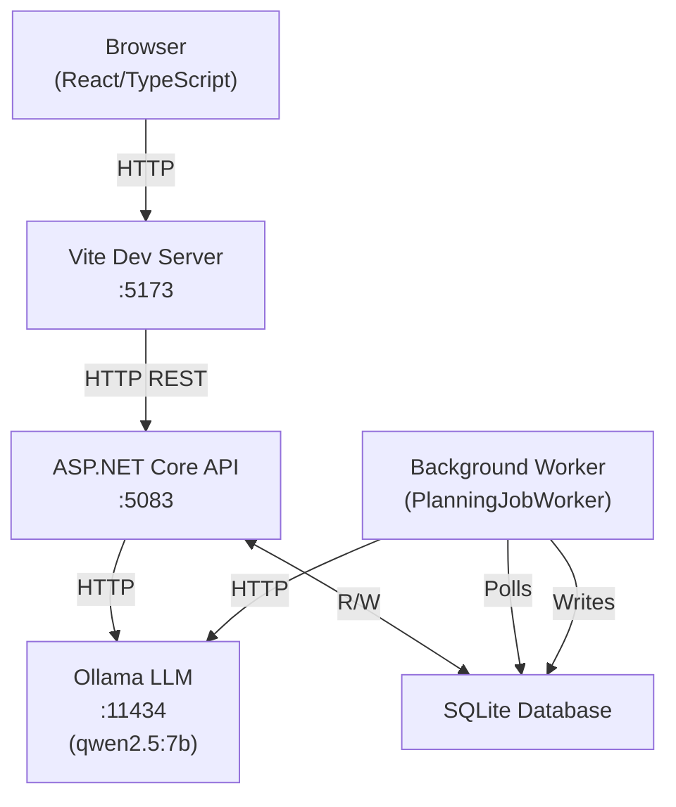
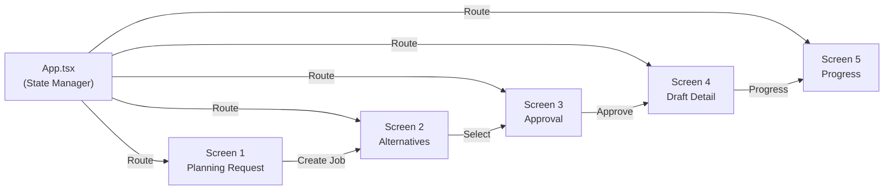
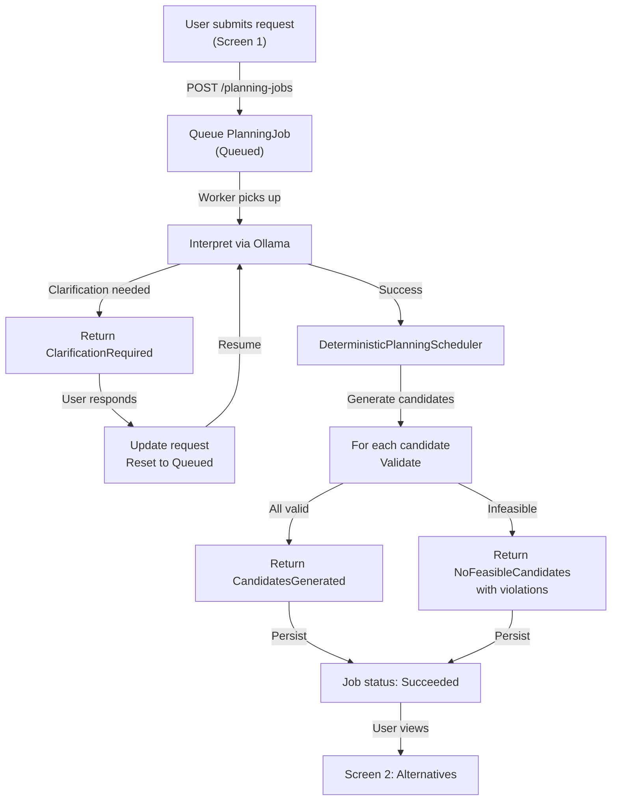
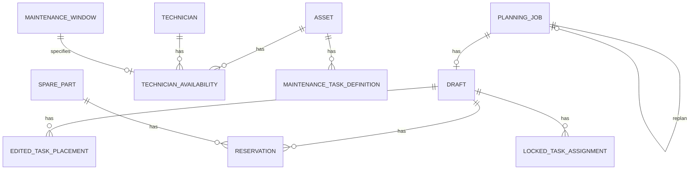
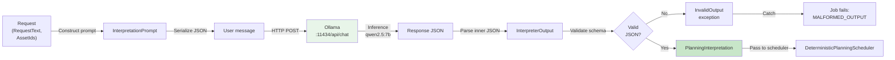
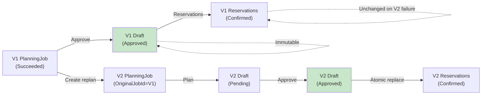

# System Design and Architecture
## AI Maintenance Planner

**Date:** 2026-10-26  
**Scope:** Component architecture, workflows, Ollama integration, and persistence design.

---

## High-Level Architecture



---

## Frontend Architecture (5 Screens)



**Implementation Files:**
- `frontend/src/App.tsx` — State and routing
- `frontend/src/screens/PlanningRequestScreen.tsx` — Screen 1
- `frontend/src/screens/AlternativesScreen.tsx` — Screen 2
- `frontend/src/screens/ApprovalScreen.tsx` — Screen 3
- `frontend/src/screens/DraftDetailScreen.tsx` — Screen 4
- `frontend/src/screens/ProgressScreen.tsx` — Screen 5

---

## Backend API Endpoints

| Method | Path | Implementation | Purpose |
|--------|------|---|---|
| POST | `/api/planning-jobs` | PlanningJobEndpoints | Create job |
| GET | `/api/planning-jobs/{id}` | PlanningJobEndpoints | Poll status |
| POST | `/api/planning-jobs/{id}/clarify` | PlanningJobEndpoints | Submit clarification |
| GET | `/api/planning-jobs/{jobId}/candidates` | MaintenancePlannerEndpoints | Get candidates |
| POST | `/api/drafts/{jobId}/approve` | ApprovalEndpoints | Approve plan |
| POST | `/api/drafts/{draftId}/cancel` | ApprovalEndpoints | Cancel plan |
| GET | `/api/drafts/{draftId}` | ApprovalEndpoints | Get draft detail |
| POST | `/api/drafts/{draftId}/mark-task-complete` | PlanProgressEndpoints | Mark task done |
| GET | `/api/drafts/{draftId}/progress` | PlanProgressEndpoints | Get progress |
| GET | `/api/drafts/{draftId}/export/json` | PlanProgressEndpoints | Export JSON |
| GET | `/api/drafts/{draftId}/export/pdf` | PlanProgressEndpoints | Export PDF |
| POST | `/api/drafts/{draftId}/task-edits` | EditEndpoints | Submit edits |
| GET | `/api/drafts/{draftId}/task-edits` | EditEndpoints | Get edits |

---

## Service Architecture

```mermaid
graph LR
    PlanJobs["IPlanningJobs<br/>(Job lifecycle)"]
    Interp["OllamaPlanningRequestInterpreter<br/>(LLM)"]
    Sched["DeterministicPlanningScheduler<br/>(Scheduling)"]
    Valid["PlanningCandidateValidator<br/>(Validation)"]
    Appr["IDraftApprovalService<br/>(Approval)"]
    Prog["IPlanProgressService<br/>(Progress)"]
    Exp["IPlanExportService<br/>(Export)"]
    Edit["ITaskEditorService<br/>(Edits)"]
    
    PlanJobs -->|Uses| Interp
    Interp -->|Pass| Sched
    Sched -->|Validate| Valid
    Valid -->|Return| Appr
    Appr -->|Track| Prog
    Prog -->|Serialize| Exp
    Exp -->|Support| Edit
```



**Implementation Files:**
- `src/MaintenancePlanner.Infrastructure/Planning/` — Interpreters, schedulers
- `src/MaintenancePlanner.Infrastructure/Approvals/` — Approval service
- `src/MaintenancePlanner.Infrastructure/Queries/` — Read models
- `src/MaintenancePlanner.Infrastructure/Edits/` — Task editor

---

## Planning Workflow



---

## Approval and Reservation Workflow

```mermaid
graph TD
    A["User approves<br/>(Screen 3)"] -->|POST /drafts/{jobId}/approve| B["Check job outcome"]
    B -->|CandidatesGenerated| C["Create Draft<br/>(Pending)"]
    B -->|Other| D["Return error"]
    C -->|For each reserved part| E["Check OnHandQuantity"]
    E -->|Insufficient| F["Return 409 Conflict<br/>INSUFFICIENT_STOCK"]
    E -->|Available| G["Create Reservation<br/>(Confirmed)"]
    G -->|All ok| H["Atomic transaction commit"]
    H -->|Update Draft status| I["Draft: Approved<br/>ApprovedAtUtc: now"]
    I -->|Return 202| J["Response: /api/drafts/{draftId}"]
    F -->|No draft created| K["Show error<br/>Parts not reserved"]
    J -->|Auto-navigate| L["Screen 4: Draft Detail"]
```

---

## Database Schema (Key Entities)



**Key Tables:**

| Entity | Purpose | Key Fields |
|--------|---------|-----------|
| PlanningJob | Job state & results | Id, Status, RequestPayload, ResultPayload, OriginalJobId, OperationId |
| Draft | Approved plan | Id, PlanningJobId, Status, ApprovedCandidatePayload, ApprovedAtUtc |
| Reservation | Reserved part | Id, DraftId, SparePartId, Quantity, Status, CompletionTime |
| LockedTaskAssignment | User decision lock | Id, DraftId, TaskId, TechnicianIds |
| EditedTaskPlacement | User edits | Id, DraftId, TaskId, NewStart, NewEnd |
| Asset | Equipment | Id, Name, Model |
| MaintenanceTaskDefinition | Task catalogue | Id, AssetId, Name, DurationMinutes, RequiredSkill, SourceDocumentId |
| SparePart | Inventory | Id, Name, OnHandQuantity, ReservedQuantity |
| Technician | Resource | Id, Name, HourlyRate |
| TechnicianAvailability | Time windows | Id, TechnicianId, MaintenanceWindowId, StartTime, EndTime |

---

## Ollama Integration Flow



**File:** `src/MaintenancePlanner.Infrastructure/Planning/OllamaPlanningRequestInterpreter.cs`

---

## Revision and State Lifecycle



---

## Key Design Decisions

1. **Deterministic Scheduling** — Not ML-optimized; fully auditable and reproducible
2. **Separate Background Worker** — Long-running planning doesn't block API
3. **Immutable Revisions** — Approved plans cannot be changed after approval
4. **Atomic Approval** — Reservations either all succeed or none do
5. **Idempotent Operations** — Safe retries via OperationId
6. **Local Ollama** — No API costs; all inference local; can be swapped for cloud LLM

---

## Azure Architecture (Proposed, Not Implemented)

For future cloud deployment:
- **Frontend:** Azure Static Web Apps (CDN)
- **API:** Azure App Service (auto-scale)
- **Database:** Azure SQL Database (managed)
- **Worker:** Azure Service Bus + Azure Functions
- **Ollama:** Azure Container Instances or dedicated GPU compute
- **Monitoring:** Application Insights

---

## Persistence and Recovery

- **State Persistence:** PlanningJob with checkpoint payload allows resume from interruption
- **Atomic Transactions:** EF Core ensures consistent writes
- **Lease-Based Recovery:** Jobs with expired leases can be reclaimed
- **Idempotency:** OperationId prevents duplicate job creation on retry

---

## Known Limitations

- **Single Model:** Only qwen2.5:7b; can be configured to other models
- **SQLite:** Local testing only; production requires PostgreSQL/SQL Server
- **No Auth:** Role selector is UI-only; no backend authentication
- **Scheduling:** Heuristic-based, not globally optimal
- **No OCR:** Text manuals only; scanned/image manuals not supported

